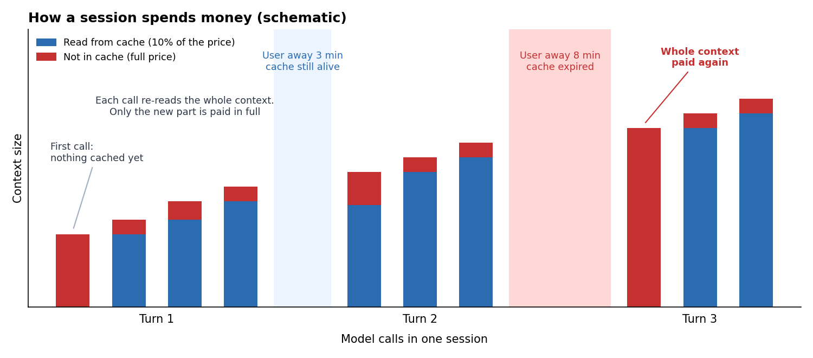
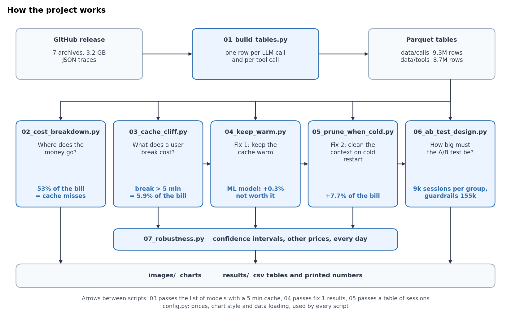
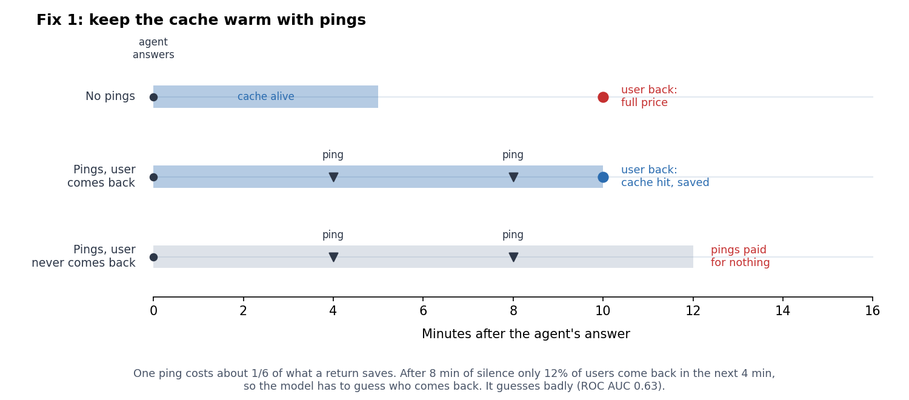
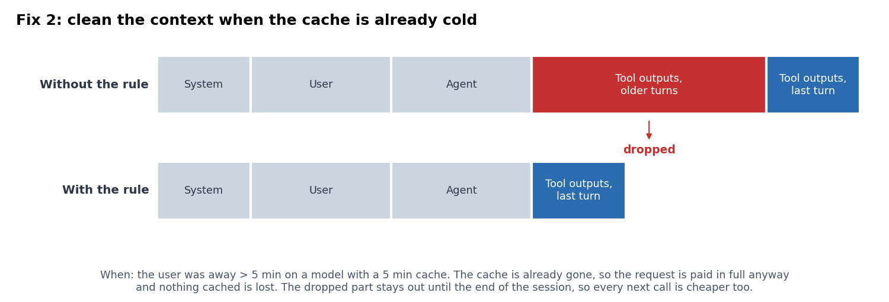

**English** | [Italiano](README_IT.md)

# The 5 minute cliff: what user breaks cost an AI coding agent

I analyzed 301k real sessions of the GitHub Copilot coding agent (June 2026, published by Microsoft in October 2026) to answer one question: where does the money go, and what is the cheapest way to spend less of it?


## Results in short

- **The agent pays for reading, not for writing.** Output is 0.8% of all tokens but 14.5% of the cost. Everything else is the agent re-reading its own context on every step.
- **14% of input tokens miss the cache, and they make up 53% of the bill.**
- **On 12 of the 21 main models the cache lives only 5 minutes.** If the user replies later than that, the cache hit rate drops from about 70% to under 5% and the whole context is paid again at full price. This costs **5.9% of the bill**, about **8 times more than all model switches together (0.7%)**.
- **The obvious fix does not work.** Keeping the cache warm with small "ping" requests loses money if you do it for everyone. A model that predicts who will come back saves only 0.3%, and even perfect foresight would save just 2%.
- **What works is the opposite.** When the cache has already expired, the context can be changed for free. If at this moment I drop old tool outputs, the bill goes down by **7.7%**. How much the agent then reads again I did not guess but measured on 7k cases where Copilot did a similar cleanup by itself: 18%. Measured on June 5-7, the same test days as in fix 1.
- **The test for it can be small, but the guardrails can't.** To see the saving an A/B test needs 9k sessions per group (2 times less than a plain test, thanks to filtering and CUPED). To be sure the agent does not get worse it needs about 155k.
- **The numbers are stable.** The 95% confidence intervals are narrow and the picture is the same on every day. With other price lists the cost of user breaks moves (1.4% to 6.7% of the bill), but it is always about 8 times more than model switches, and fix 2 always saves 7.7% to 8.8%.


**My unpopular conclusion:** most advice about LLM costs is about picking a cheaper model. In this data model switching is a small thing. The user's coffee break matters much more, and the right answer to it is not to fight the cache expiry but to use it.

## How a session spends money



The agent works in turns. In one turn it calls the model, runs a tool, adds the result to the context and calls the model again, many times. Every call sends the whole context again. The part that was already sent before usually comes from the cache and costs 10% of the price, only the new part is paid in full. But the cache lives for a limited time. If the user is away too long before the next message, the cache expires and the next call pays for the whole context again. This project is about how much these moments cost and what to do with them.

## Data

- Source: [GitHub Copilot Coding Agent Traces 2026](https://github.com/Azure/AzurePublicDataset/blob/master/GitHubCopilotCodingAgentDataset2026.md) (CC-BY), paper: [Agentic Coding in the Wild](https://arxiv.org/abs/2608.00101).
- 7 days (June 1-7, 2026), 301,026 sessions, 9.3M LLM calls, 8.7M tool calls.
- For every LLM call: timestamp, duration, anonymized model, input / cached / output tokens and the size of each part of the prompt (system, user, assistant, tool). For every tool call: name, status and duration.
- There are no prompts, no code and no signal if the task was solved.
- 29k sessions have no token counts, I dropped them. 271,932 sessions and 9.06M LLM calls are left.

**Prices.** Models are anonymized, so I use one reference price list: $3 per 1M input tokens, $0.30 per 1M cached input tokens, $15 per 1M output tokens. With these prices the whole sample costs $507k. All $ numbers below are estimates for this 7-day sample, not the real costs of Copilot.

## How the project works



`01_build_tables.py` turns the raw JSON traces into two flat tables. Every next script answers one question, saves its charts to `images/` and its numbers to `results/`. Sections 1 to 6 below follow the scripts 02 to 07.

## 1. Where the money goes


The agent works in a loop: call the model, run a tool, add the result to the context, call the model again. Every call re-reads the full context, so input tokens are 99% of the volume. 85% of them come from the cache at 10% of the price. The other 14% are paid in full, and this small part is the biggest item of the bill.


Almost half of the context is output of the agent's own tools: file contents, terminal output, search results. Once a file is read, it stays in the context and is paid again on every next call.


The median session costs $0.47, but the distribution has a long tail: the top 1% of sessions take 19% of the money and the top 10% take 61%.

## 2. The 5 minute cliff

I looked at the first model call after the user writes a new message and grouped these calls by how long the user was away (chart at the top). Models split into two clear groups:

- **12 models with a 5 minute cache** (74% of the spend). Up to 4 minutes about 70% of the context comes from the cache. Between 5 and 6 minutes it is 13%, after 10 minutes 4%.
- **9 models with a longer cache.** After 20 minutes they still keep about 58%.

To get the cost of the cliff I took every turn where the user was away for more than 5 minutes on the first group of models and compared the real cached tokens with what the same model gets after a short break (10 seconds to 4 minutes).


Model switches also reset the cache (only 18% hit after a switch), and 7.2% of sessions have one. But in total they cost 0.7% of the bill. Users who take a break of more than 5 minutes cost 5.9%.

## 3. Fix 1: keep the cache warm (does not work)

The idea: while the user is away, send a tiny request every 4 minutes so the cache does not expire. A ping is a cached read of the full context, so it costs about 1/6 of what we save when the user comes back. It pays off only if the user really comes back soon.



I tried three versions:
- **Ping everyone** for a fixed time.
- **Ping when a model expects the user back.** Gradient boosting (scikit-learn `HistGradientBoostingClassifier`) with 15 features known at the end of the turn: message number in the session, earlier pauses, context size, length of the last answer, last tool, tool errors, how the turn ended, model, hour. Trained on June 1-4, the threshold is also picked on June 1-4, results are on June 5-7.
- **Perfect foresight:** ping only users who will come back in time. This is the upper limit for any model.


Pinging everyone loses money, and the longer you keep the cache warm, the more you lose. The model is a bit better than random (ROC AUC 0.63) and saves only 0.3%. Even perfect foresight gives just 2 to 2.6%.

The reason: after 22% of the agent's answers the user never comes back, and the others come back at very different times. After 8 minutes of silence only 12% come back in the next 4 minutes, which is less than one in six, so one more ping does not pay off.

## 4. Fix 2: clean the context when the cache is already cold (works)

When the user comes back after more than 5 minutes on a short-cache model, the next request is read almost fully at full price anyway (5.4% cache hit). This is the only moment when the context can be changed without losing anything that is cached.

The rule I tested: on such a "cold restart", drop the tool outputs from older turns and keep only the outputs of the last turn. The dropped tokens stay out of the context until the end of the session, so all next calls are cheaper too.



- 203k cold restarts in the week. The rule removes 11.4% of all input tokens.
- If the agent never needed the dropped content again, the rule would save 9.4% of the bill on the test days. But some of it will be read again, so I measured how much.

**How much does the agent read again?** Copilot already does something similar by itself: sometimes the tool outputs in the context fall to almost zero while user and agent messages stay. I found 6,980 such cleanups at the start of a turn after a break of more than 5 minutes, the same moment when my rule works. For each one I compared how much new tool output the agent added in the 10 calls before and after the user's message. As a comparison group I used turn starts after a break of more than 5 minutes without a cleanup, with a similar position in the session and a similar amount of tool output in the context (difference in differences).


Before the message both lines go together, so the comparison group is fair. After a cleanup the agent reads more for about 8 calls and then goes back to normal. In total it reads back **18% of what was removed** (95% CI 15.9% to 19.7%, bootstrap over cleanups).

- With this measured share the rule saves **7.7% of the bill** on the test days (95% CI 7.5% to 7.9%).
- Even if the agent had to read back half of it, the rule would still save 4.7%, more than double the best possible result of fix 1.
- It is a simple rule with no model, and it does not touch the 9 models that keep the cache longer, where cleaning would break a warm cache.

## 5. How I would test it

The data has no quality signal, so the rule needs an A/B test before launch.

- **Unit:** session.
- **Treatment:** drop old tool outputs on cold restarts (only on models with a 5 minute cache).
- **Main metric:** cost per session.
- **Guardrails:** turns per session and share of sessions with a user cancel. If the agent gets worse, people write more messages and stop it more often.

To size the test I simulated it on real sessions: split them into two groups at random, took the measured saving away from the cost of group B and checked how often the test finds the difference (400 runs for each size). First I ran an A/A test without any effect: the false positive rate is 4.1% to 4.4%, so the method does not invent effects.

Session cost has a very long tail, so a plain test needs a lot of data. Two standard tricks help:

- **Count only the sessions where the rule fires.** It fires in 26% of sessions, they make 62% of the cost, and inside them the effect is -12.6% instead of -7.8%. The control group also logs "the rule would fire here", so the filter is the same in A and B.
- **CUPED.** The cost of the session before the rule fires for the first time can't be changed by the rule, and it explains a part of the final cost (correlation 0.61). Removing this part makes the metric less noisy.


Together they cut the test from 18.1k to 9.0k sessions per group. But the guardrails need much more data, because a small change in quality is harder to see than an 8% change in cost:


| Metric | Change to detect | Sessions per group |
|---|---|---|
| Cost per session, all sessions | -7.8% | 18,100 |
| Cost per session, only where the rule fires + CUPED | -7.8% | 9,000 |
| Guardrail: sessions with a user cancel | +5% relative | 74,400 |
| Guardrail: turns per session (+ CUPED) | +2% | 155,200 |

So I would plan the test for the guardrails: about 155k sessions per group. With this size the saving itself will be found almost for sure, and a 2% drop in quality will not go unnoticed.

## 6. How much can I trust these numbers

I checked the main numbers in three ways.

**Random noise.** 95% confidence intervals with a bootstrap over sessions (1000 resamples). All intervals are narrow and none of them crosses zero. Even the +0.3% of the keep warm model is real, it is just too small to matter.


**Other prices and every day separately.**


- If cached tokens cost 25% or 50% of the input price instead of 10%, losing the cache hurts less, so user breaks cost less: 3.3% or 1.4% of the bill. With a 25% fee for writing to the cache they cost more: 6.7%. In every case they cost about 8 times more than model switches.
- The saving of fix 2 almost does not depend on prices: 7.7% to 8.8%. A dropped token is not paid in any of the next calls, cached or not, so the rule saves money with any price list.
- Every day gives the same picture. On the weekend user breaks cost a bit less (4.4% to 4.7% instead of about 6%), the saving stays between 6.6% and 8.3%.
- I did not recount fix 1 with other prices. When cached tokens get more expensive, pings get more expensive too, so it can only get worse.

## Limitations

- Prices are my assumption. Section 6 shows how the numbers move with other price lists.
- No quality labels: I measure cost only.
- One week of data, sessions can't be linked to the same user.
- For the ping simulation I assume that a ping fully refreshes the cache and that a warm cache gives the same hit rate as after a short break.
- The guardrail thresholds (+2% turns, +5% cancels) are my choice. In the test simulation every session gets exactly its measured saving, in a real test the effect will be noisier.
- The 18% re-read share is measured on Copilot's own cleanups, and they are not exactly my rule: Copilot drops all tool outputs (my rule keeps the last turn) and sometimes adds a summary. The confidence interval covers only random noise, not this difference.

## How to run

```bash
python -m venv .venv
source .venv/bin/activate
pip install -r requirements.txt
bash download_data.sh
python 01_build_tables.py
python 02_cost_breakdown.py
python 03_cache_cliff.py
python 04_keep_warm.py
python 05_prune_when_cold.py
python 06_ab_test_design.py
python 07_robustness.py
python 08_diagrams.py
```

The download is about 3.2 GB. `01_build_tables.py` takes about 5 minutes on a laptop, the other scripts take seconds to a minute.

## Project structure

```
01_build_tables.py      raw json traces -> parquet tables (one row per LLM call / tool call)
02_cost_breakdown.py    tokens vs cost, what the context is made of, cost per session
03_cache_cliff.py       cache hit rate vs user idle time, cost of idle vs model switches
04_keep_warm.py         fix 1: keep the cache warm, with and without a model
05_prune_when_cold.py   fix 2: drop old tool outputs on cold restarts, measure re-reading, final comparison
06_ab_test_design.py    A/B test simulation: A/A check, power, CUPED, sample sizes
07_robustness.py        confidence intervals, other price lists, every day separately
08_diagrams.py          schemes for the README (english and italian versions)
config.py               prices, chart style, data loading
images/                 charts used in this README
results/                csv tables and printed outputs of every script
```
