[English](README.md) | **Italiano**

# Il precipizio dei 5 minuti: quanto costano le pause dell'utente a un agente di coding AI

Ho analizzato 301 mila sessioni reali dell'agente di coding di GitHub Copilot (giugno 2026, pubblicate da Microsoft a ottobre 2026) per rispondere a una domanda: dove vanno i soldi e qual è il modo più economico per spenderne meno?

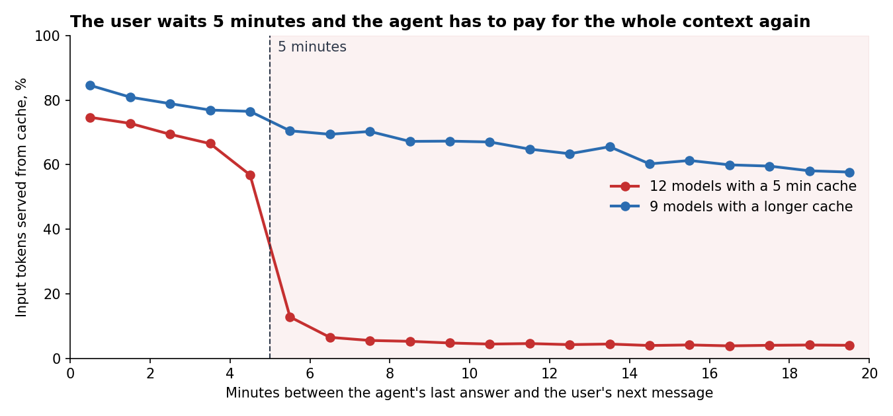

## Risultati in breve

- **L'agente paga per leggere, non per scrivere.** L'output è lo 0,8% di tutti i token ma il 14,5% del costo. Tutto il resto è l'agente che rilegge il proprio contesto a ogni passo.
- **Il 14% dei token di input non trova la cache e vale il 53% della spesa.**
- **Su 12 dei 21 modelli principali la cache dura solo 5 minuti.** Se l'utente risponde più tardi, la quota di token letti dalla cache scende da circa il 70% a meno del 5% e tutto il contesto viene pagato di nuovo a prezzo pieno. Questo costa il **5,9% della spesa**, circa **8 volte più di tutti i cambi di modello messi insieme (0,7%)**.
- **La soluzione ovvia non funziona.** Tenere la cache calda con piccole richieste "ping" fa perdere soldi se lo si fa per tutti. Un modello che prevede chi tornerà fa risparmiare solo lo 0,3%, e anche una previsione perfetta darebbe solo il 2%.
- **Funziona il contrario.** Quando la cache è già scaduta, il contesto si può modificare gratis. Se in quel momento elimino i vecchi output dei tool, la spesa scende del **7,7%**. Quanto l'agente poi rilegge non l'ho ipotizzato ma l'ho misurato su 7 mila casi in cui Copilot ha fatto da solo una pulizia simile: il 18%. Misurato sul 5-7 giugno, gli stessi giorni di test della soluzione 1.
- **Il test può essere piccolo, i guardrail no.** Per vedere il risparmio un test A/B ha bisogno di 9 mila sessioni per gruppo (la metà di un test semplice, grazie al filtro e a CUPED). Per essere sicuri che l'agente non peggiori ne servono circa 155 mila.
- **I numeri sono stabili.** Gli intervalli di confidenza al 95% sono stretti e il quadro è lo stesso ogni giorno. Con altri listini prezzi il costo delle pause cambia (dall'1,4% al 6,7% della spesa), ma è sempre circa 8 volte più dei cambi di modello, e la soluzione 2 fa sempre risparmiare dal 7,7% all'8,8%.

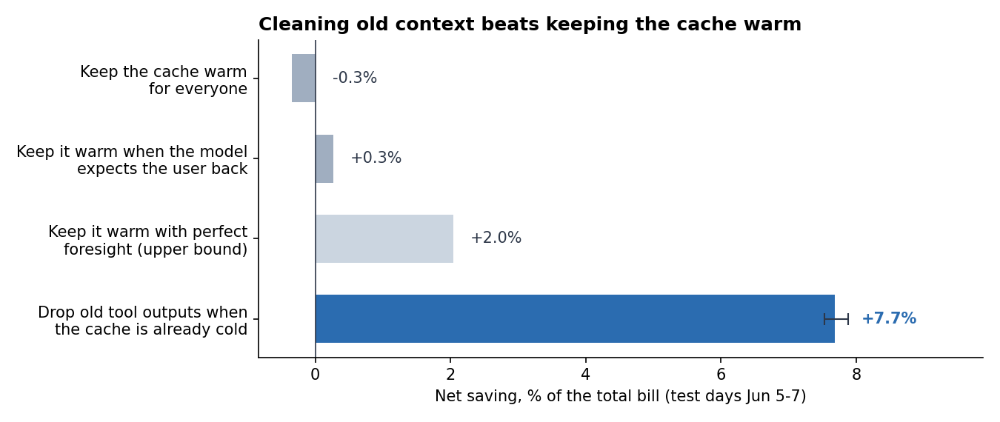

**La mia conclusione impopolare:** quasi tutti i consigli sui costi degli LLM parlano di scegliere un modello più economico. In questi dati il cambio di modello conta poco. La pausa caffè dell'utente conta molto di più, e la risposta giusta non è combattere la scadenza della cache ma sfruttarla.

## Come una sessione spende soldi

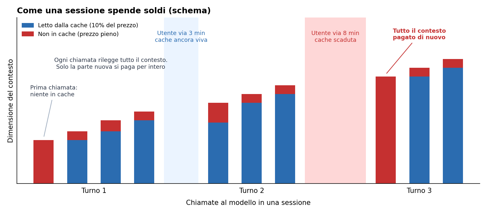

L'agente lavora a turni. In un turno chiama il modello, esegue un tool, aggiunge il risultato al contesto e chiama di nuovo il modello, molte volte. Ogni chiamata invia di nuovo tutto il contesto. La parte già inviata prima di solito arriva dalla cache e costa il 10% del prezzo, solo la parte nuova si paga per intero. Ma la cache vive per un tempo limitato. Se l'utente resta via troppo a lungo prima del messaggio successivo, la cache scade e la chiamata successiva paga di nuovo tutto il contesto. Questo progetto parla di quanto costano questi momenti e di cosa farne.

## Dati

- Fonte: [GitHub Copilot Coding Agent Traces 2026](https://github.com/Azure/AzurePublicDataset/blob/master/GitHubCopilotCodingAgentDataset2026.md) (CC-BY), articolo: [Agentic Coding in the Wild](https://arxiv.org/abs/2608.00101).
- 7 giorni (1-7 giugno 2026), 301.026 sessioni, 9,3 milioni di chiamate LLM, 8,7 milioni di chiamate ai tool.
- Per ogni chiamata LLM: timestamp, durata, modello anonimizzato, token di input / in cache / di output e la dimensione di ogni parte del prompt (system, user, assistant, tool). Per ogni chiamata a un tool: nome, stato e durata.
- Non ci sono prompt, né codice, né un segnale che dica se il task è stato risolto.
- 29 mila sessioni non hanno il conteggio dei token, le ho escluse. Restano 271.932 sessioni e 9,06 milioni di chiamate LLM.

**Prezzi.** I modelli sono anonimizzati, quindi uso un unico listino di riferimento: $3 per 1M di token di input, $0,30 per 1M di token di input in cache, $15 per 1M di token di output. Con questi prezzi tutto il campione costa 507 mila dollari. Tutti gli importi in $ sono stime per questo campione di 7 giorni, non i costi reali di Copilot.

## Come funziona il progetto

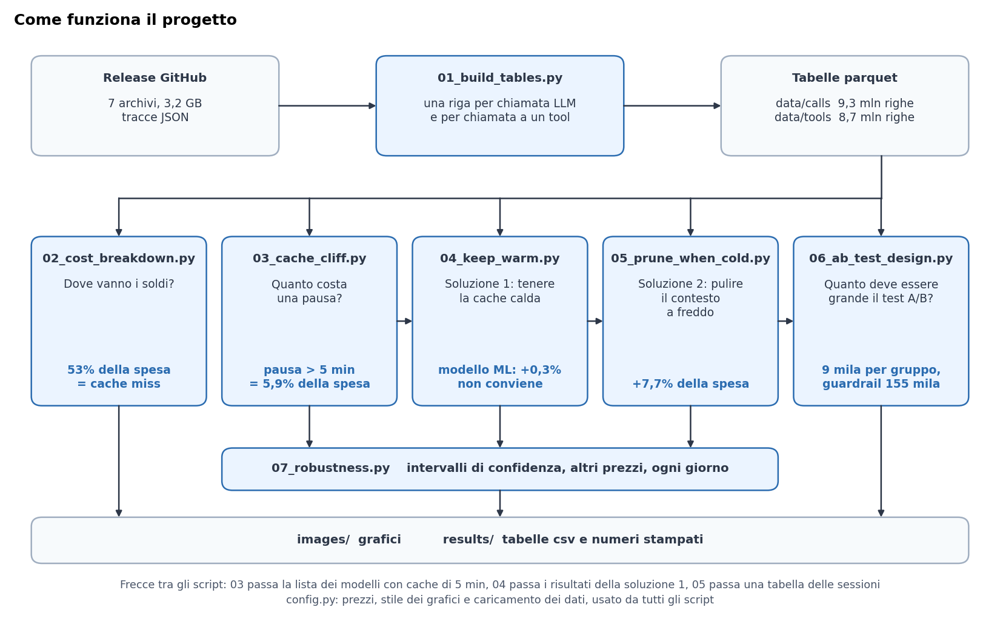

`01_build_tables.py` trasforma le tracce JSON grezze in due tabelle piatte. Ogni script successivo risponde a una domanda, salva i suoi grafici in `images/` e i suoi numeri in `results/`. Le sezioni da 1 a 6 qui sotto seguono gli script da 02 a 07.

## 1. Dove vanno i soldi

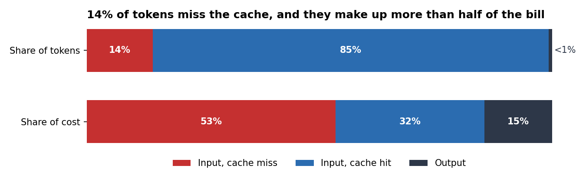

L'agente lavora in un ciclo: chiama il modello, esegue un tool, aggiunge il risultato al contesto, chiama di nuovo il modello. Ogni chiamata rilegge tutto il contesto, quindi i token di input sono il 99% del volume. L'85% arriva dalla cache al 10% del prezzo. L'altro 14% si paga per intero, e questa piccola parte è la voce più grande della spesa.

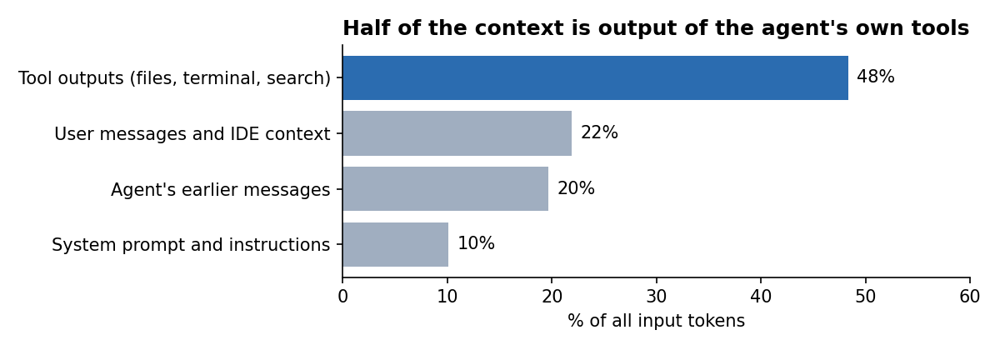

Quasi metà del contesto è output dei tool dell'agente stesso: contenuto dei file, output del terminale, risultati delle ricerche. Una volta letto, un file resta nel contesto e viene pagato di nuovo a ogni chiamata successiva.

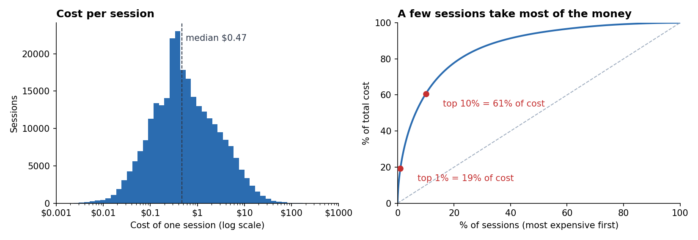

La sessione mediana costa $0,47, ma la distribuzione ha una coda lunga: l'1% delle sessioni più costose prende il 19% dei soldi e il 10% ne prende il 61%.

## 2. Il precipizio dei 5 minuti

Ho preso la prima chiamata al modello dopo che l'utente scrive un nuovo messaggio e ho raggruppato queste chiamate per quanto tempo l'utente è stato assente (grafico in alto). I modelli si dividono in due gruppi chiari:

- **12 modelli con una cache di 5 minuti** (74% della spesa). Fino a 4 minuti circa il 70% del contesto arriva dalla cache. Tra 5 e 6 minuti è il 13%, dopo 10 minuti il 4%.
- **9 modelli con una cache più lunga.** Dopo 20 minuti ne tengono ancora circa il 58%.

Per calcolare il costo del precipizio ho preso ogni turno in cui l'utente è stato assente più di 5 minuti sul primo gruppo di modelli e ho confrontato i token in cache reali con quelli che lo stesso modello ottiene dopo una pausa breve (da 10 secondi a 4 minuti).

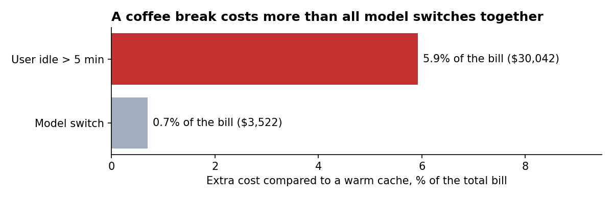

Anche il cambio di modello azzera la cache (solo il 18% di hit dopo un cambio), e il 7,2% delle sessioni ne ha almeno uno. Ma in totale i cambi costano lo 0,7% della spesa. Gli utenti che fanno una pausa di più di 5 minuti costano il 5,9%.

## 3. Soluzione 1: tenere la cache calda (non funziona)

L'idea: mentre l'utente è assente, inviare una piccola richiesta ogni 4 minuti così la cache non scade. Un ping è una lettura in cache di tutto il contesto, quindi costa circa 1/6 di quello che si risparmia quando l'utente torna. Conviene solo se l'utente torna davvero presto.

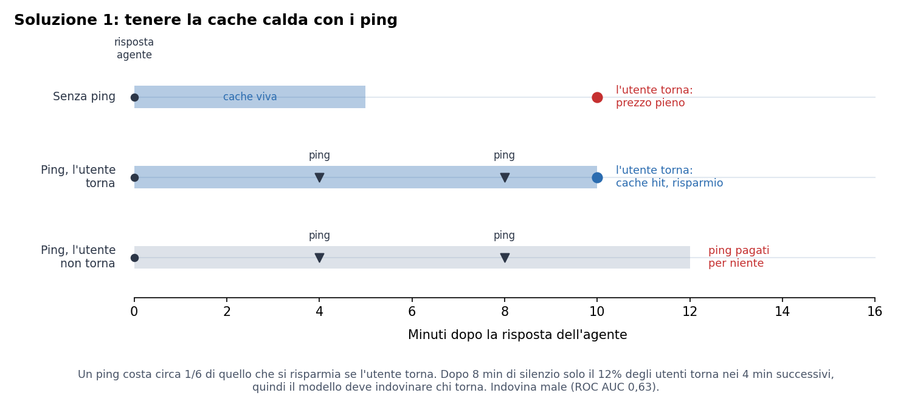

Ho provato tre versioni:
- **Ping a tutti** per un tempo fisso.
- **Ping quando un modello prevede che l'utente tornerà.** Gradient boosting (scikit-learn `HistGradientBoostingClassifier`) con 15 feature note alla fine del turno: numero del messaggio nella sessione, pause precedenti, dimensione del contesto, lunghezza dell'ultima risposta, ultimo tool, errori dei tool, come è finito il turno, modello, ora. Addestrato sull'1-4 giugno, anche la soglia è scelta sull'1-4 giugno, i risultati sono sul 5-7 giugno.
- **Previsione perfetta:** ping solo agli utenti che torneranno in tempo. È il limite massimo per qualsiasi modello.

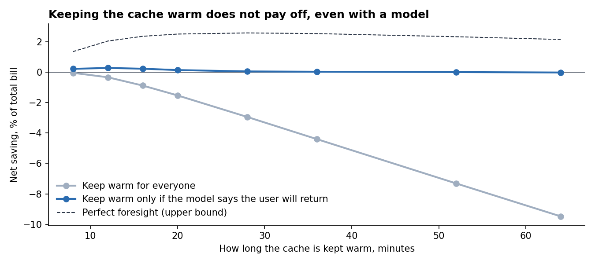

Fare ping a tutti fa perdere soldi, e più a lungo si tiene calda la cache, più si perde. Il modello è poco meglio del caso (ROC AUC 0,63) e fa risparmiare solo lo 0,3%. Anche la previsione perfetta dà solo dal 2 al 2,6%.

Il motivo: dopo il 22% delle risposte dell'agente l'utente non torna più, e gli altri tornano in momenti molto diversi. Dopo 8 minuti di silenzio solo il 12% torna nei 4 minuti successivi, cioè meno di uno su sei, quindi un ping in più non conviene.

## 4. Soluzione 2: pulire il contesto quando la cache è già fredda (funziona)

Quando l'utente torna dopo più di 5 minuti su un modello con cache corta, la richiesta successiva viene letta quasi tutta a prezzo pieno comunque (5,4% di hit). È l'unico momento in cui il contesto si può cambiare senza perdere niente di ciò che è in cache.

La regola che ho testato: a ogni "ripartenza a freddo" elimino gli output dei tool dei turni più vecchi e tengo solo quelli dell'ultimo turno. I token eliminati restano fuori dal contesto fino alla fine della sessione, quindi costano meno anche tutte le chiamate successive.

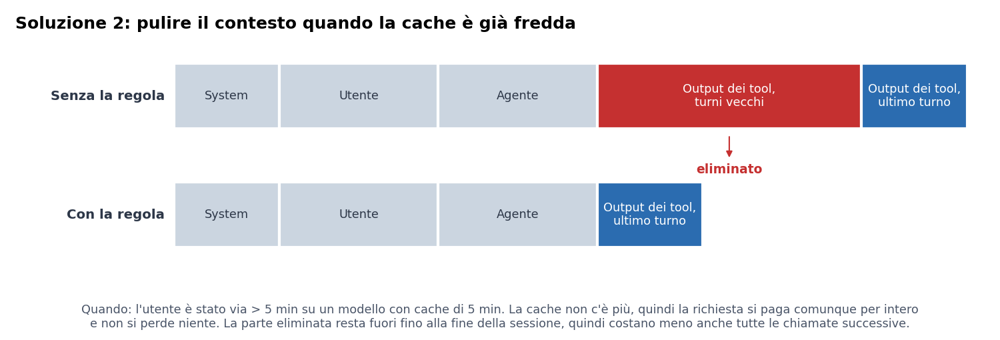

- 203 mila ripartenze a freddo nella settimana. La regola toglie l'11,4% di tutti i token di input.
- Se l'agente non avesse mai più bisogno del contenuto eliminato, la regola farebbe risparmiare il 9,4% della spesa nei giorni di test. Ma una parte verrà riletta, quindi ho misurato quanta.

**Quanto rilegge l'agente?** Copilot fa già da solo qualcosa di simile: a volte gli output dei tool nel contesto scendono quasi a zero mentre i messaggi dell'utente e dell'agente restano. Ho trovato 6.980 pulizie di questo tipo all'inizio di un turno dopo una pausa di più di 5 minuti, lo stesso momento in cui lavora la mia regola. Per ognuna ho confrontato quanto nuovo output dei tool l'agente ha aggiunto nelle 10 chiamate prima e dopo il messaggio dell'utente. Come gruppo di confronto ho usato inizi di turno dopo una pausa di più di 5 minuti senza pulizia, con una posizione simile nella sessione e una quantità simile di output dei tool nel contesto (difference in differences).

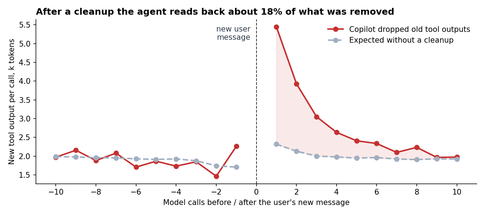

Prima del messaggio le due linee vanno insieme, quindi il gruppo di confronto è corretto. Dopo una pulizia l'agente legge di più per circa 8 chiamate e poi torna alla normalità. In totale rilegge **il 18% di quello che è stato eliminato** (IC 95% dal 15,9% al 19,7%, bootstrap sulle pulizie).

- Con questa quota misurata la regola fa risparmiare il **7,7% della spesa** nei giorni di test (IC 95% dal 7,5% al 7,9%).
- Anche se l'agente dovesse rileggerne la metà, la regola farebbe comunque risparmiare il 4,7%, più del doppio del miglior risultato possibile della soluzione 1.
- È una regola semplice, senza modello, e non tocca i 9 modelli che tengono la cache più a lungo, dove pulire il contesto romperebbe una cache calda.

## 5. Come lo testerei

I dati non hanno un segnale di qualità, quindi la regola ha bisogno di un test A/B prima del lancio.

- **Unità:** sessione.
- **Trattamento:** eliminare i vecchi output dei tool alle ripartenze a freddo (solo sui modelli con cache di 5 minuti).
- **Metrica principale:** costo per sessione.
- **Guardrail:** turni per sessione e quota di sessioni con una cancellazione dell'utente. Se l'agente peggiora, le persone scrivono più messaggi e lo fermano più spesso.

Per dimensionare il test l'ho simulato su sessioni reali: le ho divise a caso in due gruppi, ho tolto il risparmio misurato dal costo del gruppo B e ho controllato quanto spesso il test trova la differenza (400 simulazioni per ogni dimensione). Prima ho fatto un test A/A senza nessun effetto: il tasso di falsi positivi è dal 4,1% al 4,4%, quindi il metodo non inventa effetti.

Il costo delle sessioni ha una coda molto lunga, quindi un test semplice ha bisogno di molti dati. Aiutano due trucchi standard:

- **Contare solo le sessioni in cui la regola scatta.** Scatta nel 26% delle sessioni, che fanno il 62% del costo, e al loro interno l'effetto è -12,6% invece di -7,8%. Anche il gruppo di controllo registra "qui la regola scatterebbe", quindi il filtro è lo stesso in A e in B.
- **CUPED.** Il costo della sessione prima che la regola scatti per la prima volta non può essere cambiato dalla regola e spiega una parte del costo finale (correlazione 0,61). Togliendo questa parte la metrica diventa meno rumorosa.

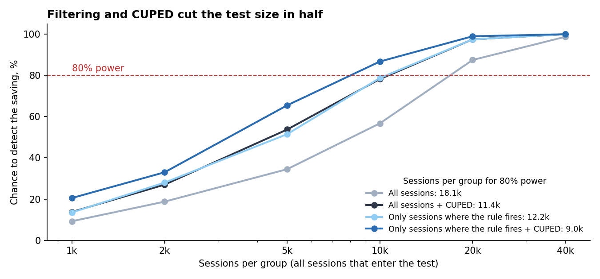

Insieme riducono il test da 18,1 mila a 9,0 mila sessioni per gruppo. Ma i guardrail hanno bisogno di molti più dati, perché un piccolo cambiamento nella qualità è più difficile da vedere di un cambiamento dell'8% nel costo:

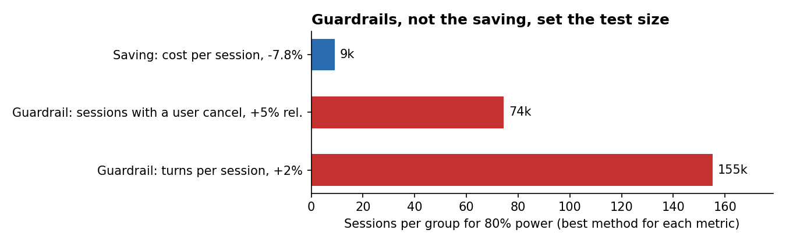

| Metrica | Cambiamento da rilevare | Sessioni per gruppo |
|---|---|---|
| Costo per sessione, tutte le sessioni | -7,8% | 18.100 |
| Costo per sessione, solo dove la regola scatta + CUPED | -7,8% | 9.000 |
| Guardrail: sessioni con una cancellazione dell'utente | +5% relativo | 74.400 |
| Guardrail: turni per sessione (+ CUPED) | +2% | 155.200 |

Quindi pianificherei il test sui guardrail: circa 155 mila sessioni per gruppo. Con questa dimensione il risparmio verrà trovato quasi di sicuro, e un calo della qualità del 2% non passerà inosservato.

## 6. Quanto ci si può fidare di questi numeri

Ho controllato i numeri principali in tre modi.

**Rumore casuale.** Intervalli di confidenza al 95% con un bootstrap sulle sessioni (1000 ricampionamenti). Tutti gli intervalli sono stretti e nessuno attraversa lo zero. Anche il +0,3% del modello per la cache calda è reale, è solo troppo piccolo per contare.

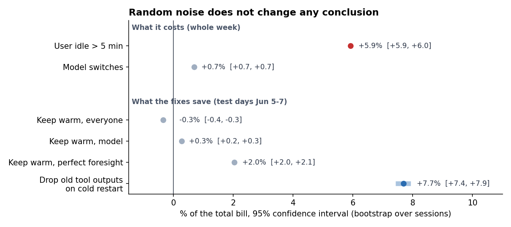

**Altri prezzi e ogni giorno separatamente.**

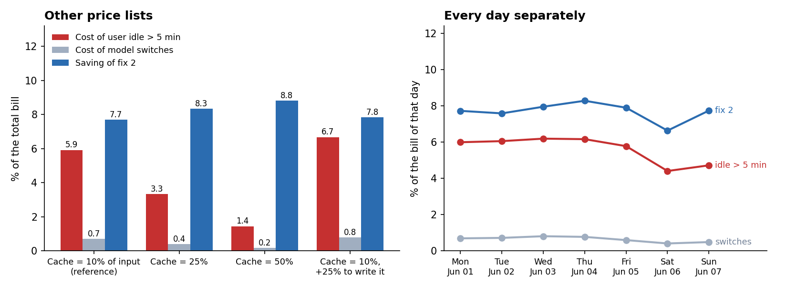

- Se i token in cache costano il 25% o il 50% del prezzo di input invece del 10%, perdere la cache costa meno, quindi anche le pause costano meno: il 3,3% o l'1,4% della spesa. Con un costo del 25% per scrivere in cache costano di più: il 6,7%. In ogni caso costano circa 8 volte più dei cambi di modello.
- Il risparmio della soluzione 2 quasi non dipende dai prezzi: dal 7,7% all'8,8%. Un token eliminato non si paga in nessuna delle chiamate successive, in cache o no, quindi la regola fa risparmiare con qualsiasi listino.
- Ogni giorno dà lo stesso quadro. Nel fine settimana le pause costano un po' meno (dal 4,4% al 4,7% invece di circa il 6%), il risparmio resta tra il 6,6% e l'8,3%.
- Non ho ricalcolato la soluzione 1 con altri prezzi. Se i token in cache costano di più, anche i ping costano di più, quindi può solo peggiorare.

## Limiti

- I prezzi sono una mia ipotesi. La sezione 6 mostra come cambiano i numeri con altri listini.
- Nessuna etichetta di qualità: misuro solo il costo.
- Una sola settimana di dati, le sessioni non si possono collegare allo stesso utente.
- Nella simulazione dei ping assumo che un ping rinnovi del tutto la cache e che una cache calda dia lo stesso hit rate di una pausa breve.
- Le soglie dei guardrail (+2% turni, +5% cancellazioni) sono una mia scelta. Nella simulazione del test ogni sessione riceve esattamente il suo risparmio misurato, in un test reale l'effetto sarà più rumoroso.
- Il 18% di rilettura è misurato sulle pulizie fatte da Copilot, che non sono esattamente la mia regola: Copilot elimina tutti gli output dei tool (la mia regola tiene l'ultimo turno) e a volte aggiunge un riassunto. L'intervallo di confidenza copre solo il rumore casuale, non questa differenza.

## Come eseguire

```bash
python -m venv .venv
source .venv/bin/activate
pip install -r requirements.txt
bash download_data.sh
python 01_build_tables.py
python 02_cost_breakdown.py
python 03_cache_cliff.py
python 04_keep_warm.py
python 05_prune_when_cold.py
python 06_ab_test_design.py
python 07_robustness.py
python 08_diagrams.py
```

Il download è di circa 3,2 GB. `01_build_tables.py` impiega circa 5 minuti su un portatile, gli altri script da pochi secondi a un minuto.

## Struttura del progetto

```
01_build_tables.py      tracce json grezze -> tabelle parquet (una riga per chiamata LLM / chiamata a un tool)
02_cost_breakdown.py    token vs costo, di cosa è fatto il contesto, costo per sessione
03_cache_cliff.py       hit rate della cache vs pausa dell'utente, costo delle pause vs cambi di modello
04_keep_warm.py         soluzione 1: tenere la cache calda, con e senza modello
05_prune_when_cold.py   soluzione 2: eliminare i vecchi output dei tool alle ripartenze a freddo, misurare la rilettura, confronto finale
06_ab_test_design.py    simulazione del test A/B: controllo A/A, potenza, CUPED, dimensione del campione
07_robustness.py        intervalli di confidenza, altri listini prezzi, ogni giorno separatamente
08_diagrams.py          schemi per il README (versione inglese e italiana)
config.py               prezzi, stile dei grafici, caricamento dei dati
images/                 grafici usati in questo README
results/                tabelle csv e output stampati di ogni script
```
